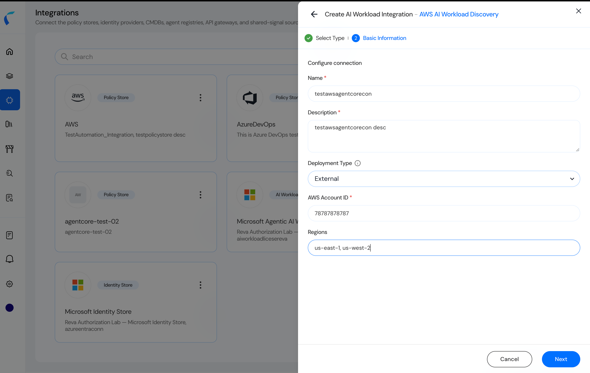
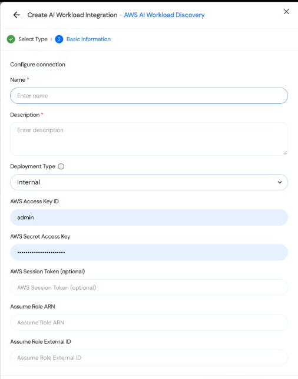
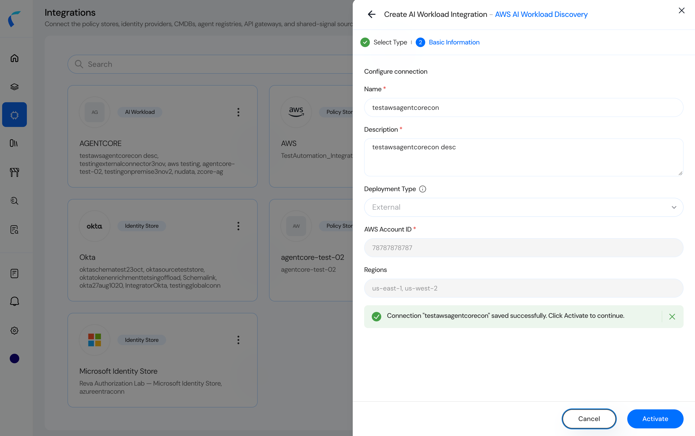
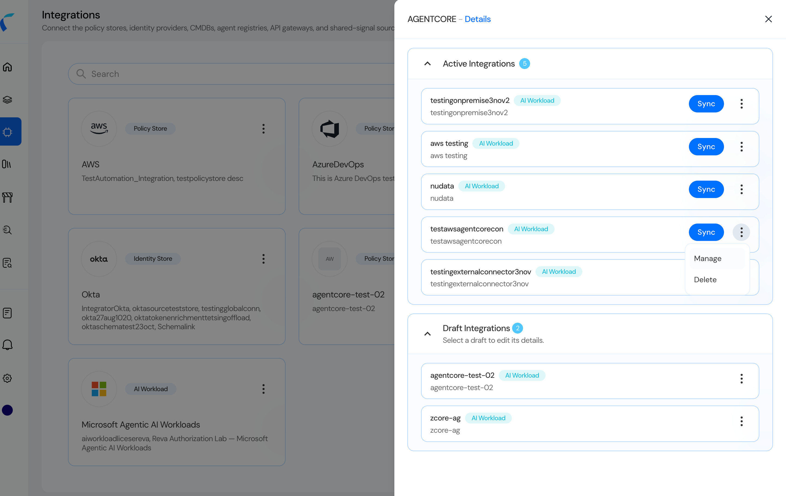
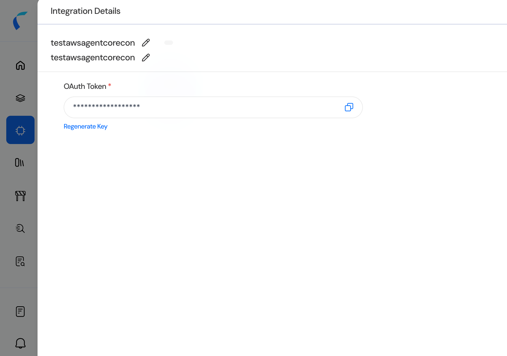

Create the integration before you deploy anything in AWS. Activation is what issues the OAuth token and unlocks the deployment zip. The AWS account ID on the form is the account that hosts the ECR image you will pull. In the current packages that account is 732029699072, the registry in the image URI 732029699072.dkr.ecr.us-east-1.amazonaws.com/ecr-awsaiworkloadconnectorsvc.

## Open AI Workload and choose the template

1. In the Reva console, open Integrations.

1. Create a connector from the AI Workload option.

1. Select AWS AI Workload Discovery and continue to Basic Information.

## Enter the connection and choose External

1. Enter a name and a description. Both are required.

1. Set Deployment Type to External.

1. Enter AWS Account ID. This is required for External. It is the account from which the ECR image is downloaded, not a label you can leave blank.

1. Enter Regions as a comma-separated list of the regions to scan, for example us-east-1, us-west-2. These are the regions the connector will search for AgentCore and Bedrock resources.

1. Click Next.

<Frame caption="Figure 1. Basic Information with Deployment Type set to External, the ECR publisher account, and the regions to scan.">
  
</Frame>

Internal is a different form. It asks for an AWS access key, a secret access key, an optional session token, an assume-role ARN, and an external ID. Do not fill those fields for the deployment in this document.

<Frame caption="Figure 2. Internal deployment. This guide does not use these fields.">
  
</Frame>

## Activate

1. On the review step, confirm the name, description, External, the account ID, and the regions.

1. Click Activate.

<Frame caption="Figure 3. Review step. Activate creates the integration and issues the OAuth token.">
  
</Frame>

## Open the integration

1. Return to the AI Workload integration that owns this connector. In the screenshots that integration is AGENTCORE.

1. On the connector row, open the menu and select Manage.

<Frame caption="Figure 4. Manage on the connector row. Sync runs later, after the connector is deployed. Delete removes the integration.">
  
</Frame>

Integration Details shows the name, the description, and the OAuth Token. The copy control next to the token is how you take the value that goes into Secrets Manager. Regenerate Key issues a new token. After a regeneration, update the secret before the next import, or the connector receives HTTP 401.

<Frame caption="Figure 5. Integration Details. Copy the OAuth Token from here. It is the store API token.">
  
</Frame>
