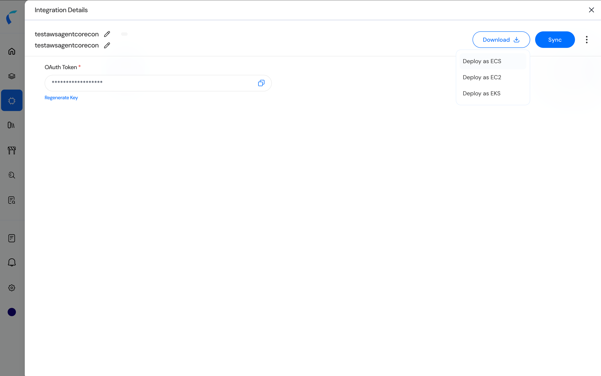

On Integration Details, open Download. The menu lists three packages. Download the package that matches the compute option you plan to use.

<Frame caption="Figure 6. Download menu: Deploy as ECS, Deploy as EC2, and Deploy as EKS.">
  
</Frame>

| Menu item | Zip | What is inside |
| --- | --- | --- |
| Deploy as EKS | agentcoreeks.zip | README_eks.md, customer-eks-permissions.json, customer-values.yaml, and the Helm chart under chart/. |
| Deploy as ECS | agentcoreecs.zip | README_ecs.md and reva-agentcore-ecs-fargate.json. |
| Deploy as EC2 | agentcoreec2.zip | README and the CloudFormation template for the EC2 deployment. The zip is complete. After the stack is up, use [Secrets Manager and the API Token](/aws-agentcore/secrets-manager-and-the-api-token) and [Start Discovery](/aws-agentcore/start-discovery) to configure the token and start the import. |

Unzip the package in the account and region where the connector will run. The README in the zip provides the command sequence. The following pages cover that sequence, along with the permissions and token configuration implemented by the templates. Update the token before the first import. The secret is created with a placeholder, which is not a valid Reva credential.

The image used by the packages is `<REVA_ECR_ACCOUNT_ID>.dkr.ecr.us-east-1.amazonaws.com/ecr-awsaiworkloadconnectorsvc`, tag v2.28.0-main-3a8feb39. The container listens on port 8055.
