This is the home dashboard — what you land on day one, and what you keep coming back to once agents, MCP servers, and connectors are actually feeding it data.

## Day Zero: Before Any Data

What a brand-new tenant sees before anything has been ingested. Inventory Summary, Threat Events Detected, Decision Insights, and Quarantined Entities are all empty, each with its own setup call-to-action.

<Frame caption="Day zero: no entities, no threat events, no decisions, no quarantined entities yet.">
  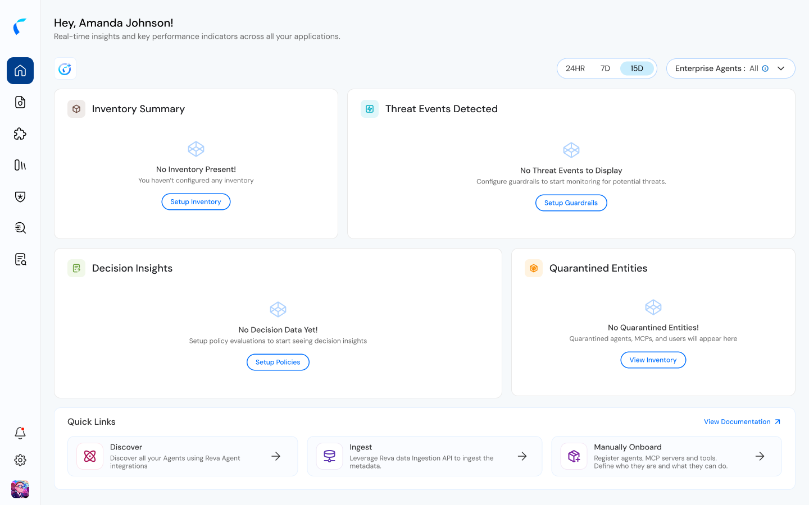
</Frame>

## The Dashboard, Populated

Once entities, decisions, and threat events are flowing in, the same four cards fill in, and **Quick Links** moves below them.

<Frame caption="The Insights dashboard after ingestion: inventory, threat events, decisions, and quarantine all populated.">
  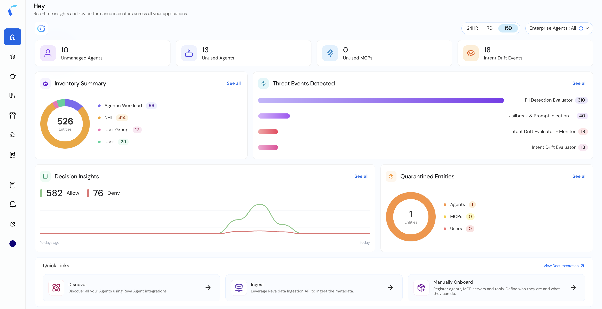
</Frame>

## Bringing Data In

Below the four cards, **Quick Links** gives three ways to start populating the inventory:

<Frame caption="Quick Links: Discover, Ingest, and Manually Onboard.">
  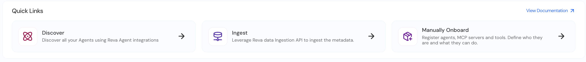
</Frame>

| Quick Link | What it does |
|:--|:--|
| **Discover** | Opens the [Integrations page](/integration-overview), where you connect the integrations that then discover entities automatically. |
| **Ingest** | Gives you the auth token and entity secrets to push entities in yourself through the ingestion API. |
| **Manually Onboard** | Creates a new policy store — specifically a **pro-code policy store** — for you to register entities into directly. |

### Discover

Opens the Integrations page, where existing connections are listed and new ones are created through **+ Integration**.

<Frame caption="Integrations page, reached from Discover.">
  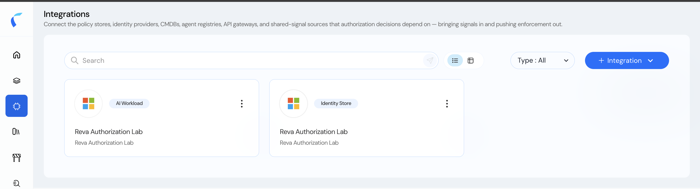
</Frame>

Creating a new one walks through **Select Type** first — the discovery connectors available here are AWS AI Workload Discovery, Microsoft Agentic AI Workloads, and Google Cloud AI Workload Discovery — then **Basic Information**.

<Frame caption="Create AI Workload Integration: choosing a discovery connector.">
  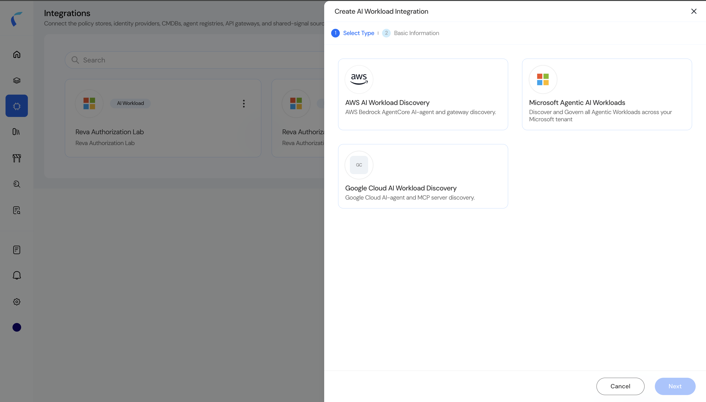
</Frame>

### Ingest

Opens **Connect to Data Fabric**: an OAuth token (regeneratable) plus the full list of entity types the ingestion API accepts — User, UserGroup, Agent, Model, Skill, API, MCPServer, Tool, ManagedIdentity, AppIdentity, Secret, Host, AccessKey.

<Frame caption="Connect to Data Fabric: the ingestion token and supported entity types.">
  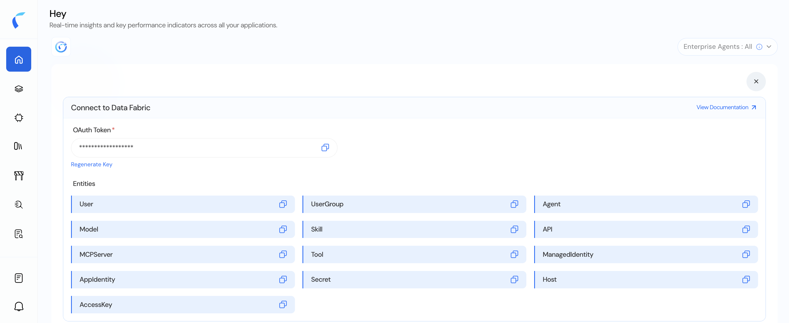
</Frame>

### Manually Onboard

Opens **Onboard Your Pro Code Agents** — a form to register an agent or AI service directly: Name, Application owner(s), Portfolio, Application Tags, and Description.

<Frame caption="Onboard Your Pro Code Agents: registering an agent by hand.">
  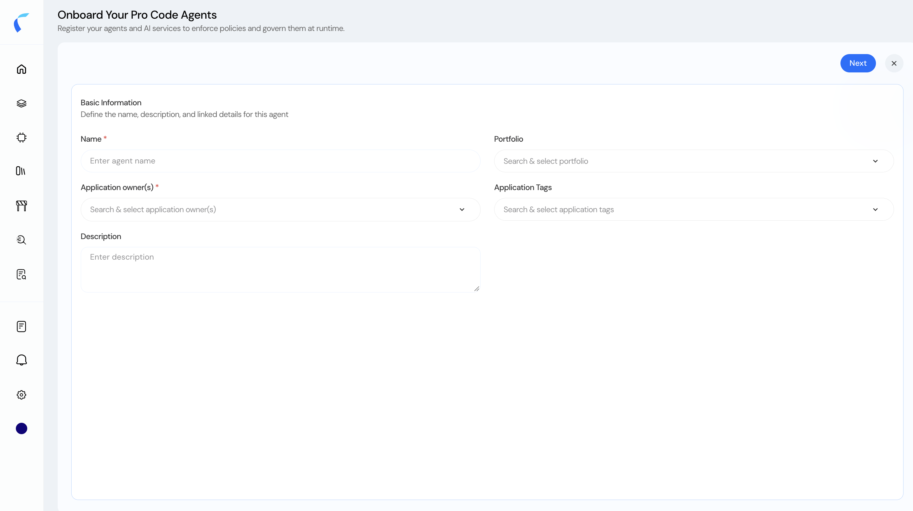
</Frame>

## Inventory Summary, Populated

Once entities have been ingested, Inventory Summary lists every entity the tenant knows about: agents, MCP servers, tools, models, APIs, skills, hosts, knowledge, app identities, access keys, secrets, users, user groups — and, separately, workspaces, repositories, folders, and files.

<Frame caption="Inventory Summary card: entities broken down by type.">
  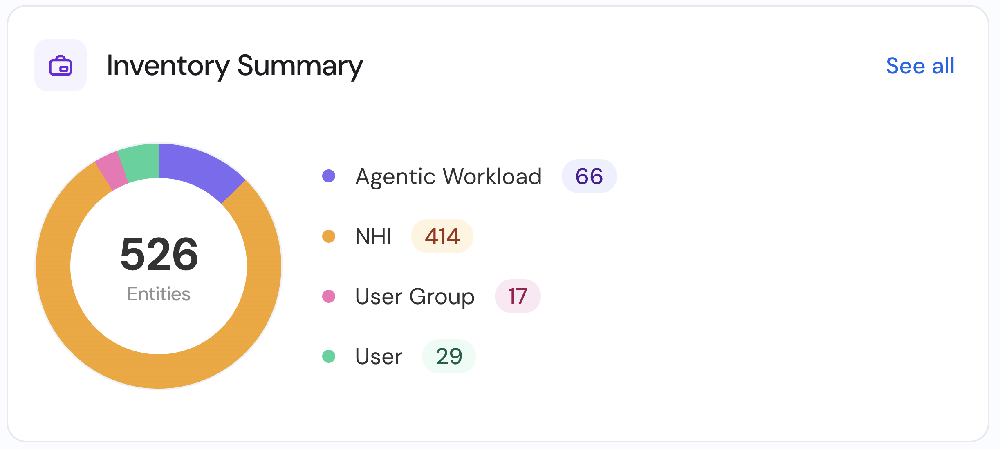
</Frame>

That last group — workspace, repository, folder, file — comes from the [SharePoint connector](/sharepoint/overview), not from AI Workload discovery. The two coexist in the same inventory view.

**See all** opens the full entity list — [Access Explorer](#explore-access) — with a tab per entity type (Agents, MCP Servers, Tools, Models, API, Skill, and more) and a filterable table of every entity in that type.

<Frame caption="Access Explorer: the populated entity inventory, filtered to Agents.">
  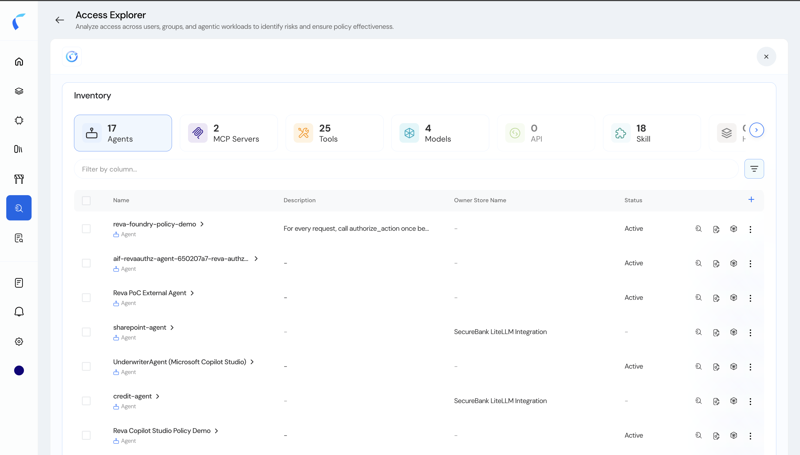
</Frame>

### Per-Entity Actions

Each entity row carries four actions: three icon buttons, plus a fourth icon that opens a menu of three more.

<Frame caption="An entity's action icons: Explore Access, Manage policies, Quarantine Access, and More.">
  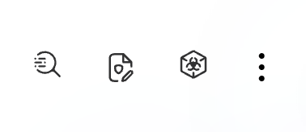
</Frame>

- **Explore Access** — opens [Access Explorer](#explore-access) scoped to this entity.
- **Manage policies** — opens a choice of **Control Policy** or **Access Policy** for this entity.
- **Quarantine Access** — quarantines the entity. See [Quarantine](#quarantine) below.
- **More (⋮)** — opens a menu with three further actions:
  - **Edit Details** — opens the entity's metadata for editing. This is the same edit flow covered in [View & Edit Entity Details](/ai-workload-entity-detail) — editing is still owner-store-only.
  - **View Decision Logs** — jumps straight to that entity's own [decision logs](/decision-logs), filtered to just its activity.
  - **View Data Ingestion Logs** — the record of how this entity was brought in. Populated when the entity was ingested through the API; a manually onboarded entity has nothing here.

<Frame caption="The More menu: Edit Details, View Decision Logs, View Data Ingestion Logs.">
  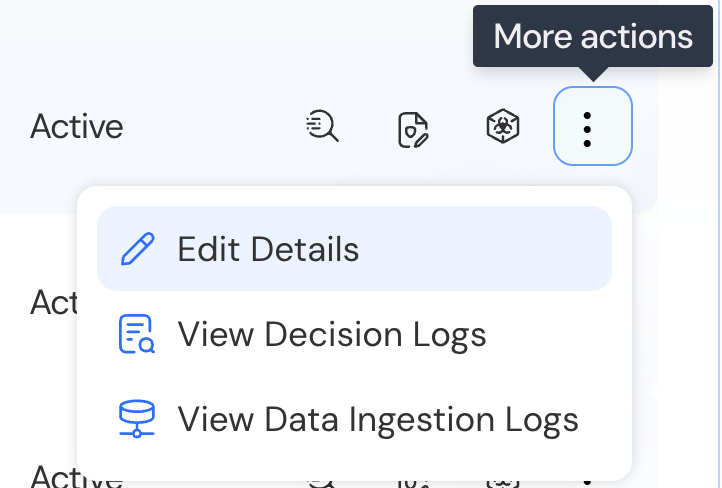
</Frame>

## Manage Policies

**Manage policies** covers two policy types: **Control Policy** and **Access Policy**.

<Frame caption="Manage policies: choosing between Control Policy and Access Policy.">
  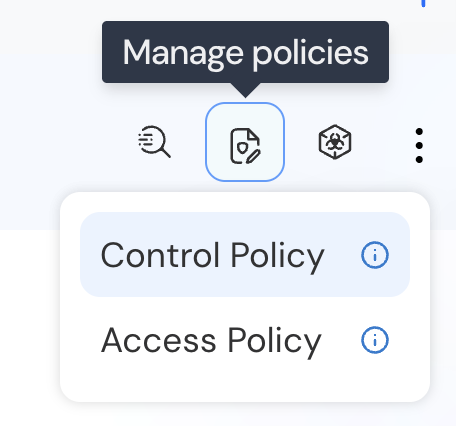
</Frame>

<Warning>
  What distinguishes a control policy from an access policy isn't settled in this draft — that explanation is coming separately. Don't guess at the difference; wait for that source before writing this section in full.
</Warning>

## Quarantine

Quarantining an agent, MCP server, or user blocks it immediately: any further action it attempts is denied by an automated forbid policy that exists in every store by default, on top of the [permit-all-then-forbid model](/ai-workload-topology-overview#the-default-posture-permit-all-then-forbid) the topology already uses. **Reinstate** is the reverse action — it removes that block and returns the entity to normal.

From the dashboard, the **Quarantined Entities** card's "See all" opens the inventory with a quarantine filter applied, showing only the entities currently in that state.

<Frame caption="Quarantined Entities card, with one agent currently quarantined.">
  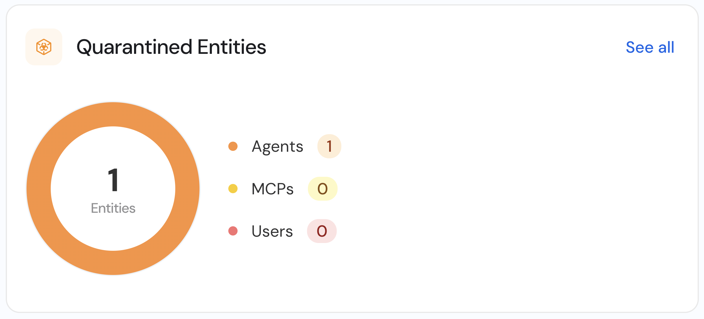
</Frame>

<Frame caption="The Quarantine Access icon.">
  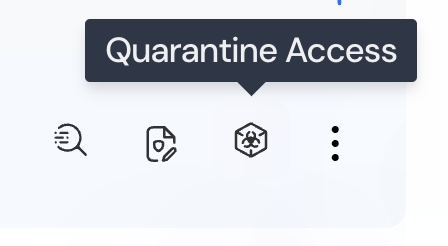
</Frame>

<Frame caption="Inventory filtered to Quarantined entities.">
  
</Frame>

## Explore Access

**Explore Access** opens [Access Explorer](/sharepoint/view-the-data-in-access-explorer) — the same page already documented for browsing SharePoint document assets, here showing AI Workload entities instead.

<Frame caption="The Explore Access icon.">
  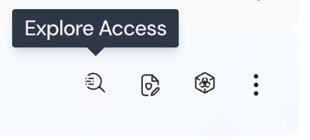
</Frame>

## Unmanaged, Unused, and Drifting

Three of the counters at the top of the dashboard:

| Counter | What it means |
|:--|:--|
| **Unmanaged Agents** | Agents with no policy store attached. Attach one and the agent stops counting as unmanaged. The same applies to unmanaged MCP servers and other entity types. |
| **Unused Agents** / **Unused MCPs** | Entities that have never been used in a prompt — their last-used value is simply "never." |
| **Intent Drift Events** | Opens the decision logs filtered to just the ones where the Intent Drift guardrail fired. |

## Guardrails

This tenant runs five guardrails: **Intent Drift Evaluator**, **Content Safety Evaluator**, **PII Detection Evaluator**, **Jailbreak & Prompt Injection Detector**, and **Secrets Detection Evaluator** — each independently set to **Monitor** or **Enforce**. These are the same guardrails and the same two modes covered in the [AI Coding Agents guardrails guide](/ai-coding-agents/guardrails/how-guardrails-work); this tenant just has five of them active rather than the full set.

**Threat Events Detected** is the decision-log view across whichever of these guardrails fired, however many are active.

<Frame caption="Threat Events Detected, broken down by guardrail.">
  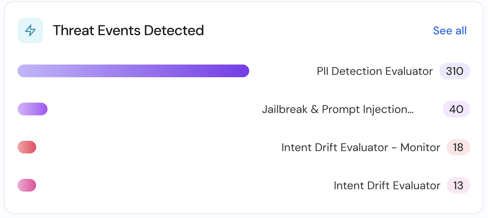
</Frame>

**Decision Insights** opens the tenant's global [decision logs](/decision-logs) directly.

<Frame caption="Decision Insights: allow vs. deny over time.">
  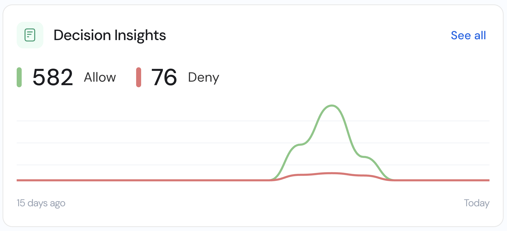
</Frame>

## Ask Reva AI

**Ask Reva AI** is Reva's own chatbot — a natural-language assistant you can open from anywhere you see its icon, docked beside whatever page you're already on.

<Frame caption="The Ask Reva AI icon.">
  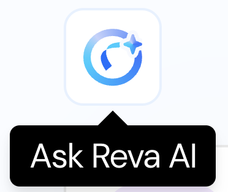
</Frame>

<Frame caption="Ask Reva AI, open beside Access Explorer.">
  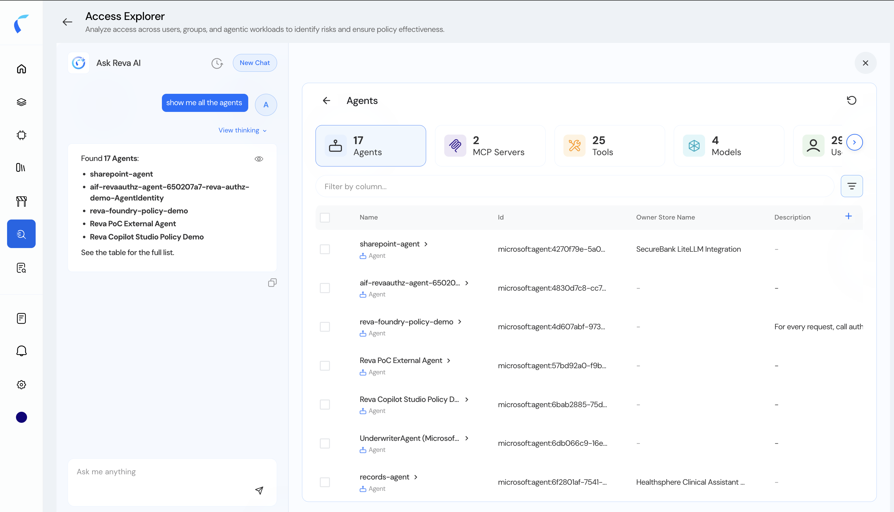
</Frame>

Ask it a question in plain language — for example, "show me all the agents" — and it answers with a direct summary (here, "Found 17 Agents" plus the first few names), an expandable **View thinking** trace of how it reasoned through the request, and the matching live view open right next to the chat, so the answer and the underlying data are visible together. **New Chat** starts a fresh conversation.
