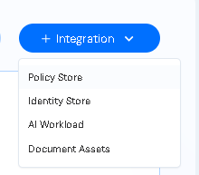
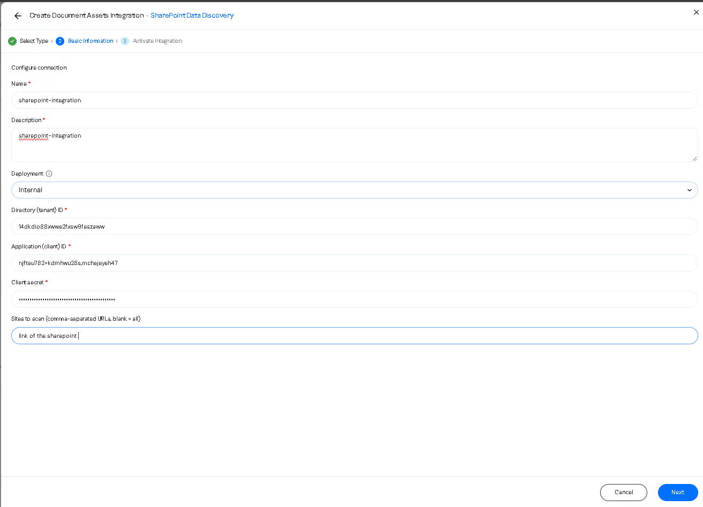
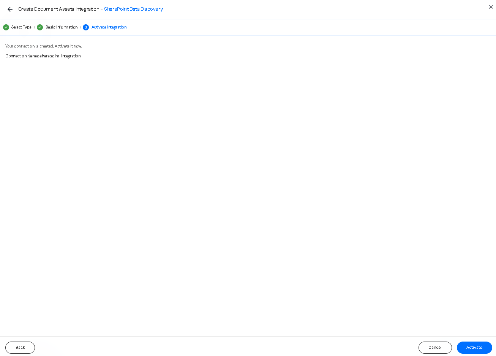

## Go to the Integrations page in Reva

1. In the Reva console, open **Integrations**.
2. Click **+ Integration** and choose **Document Assets**.
3. Select **SharePoint Data Discovery** and continue to Basic Information.

<Frame caption="Figure 3. The + Integration menu. SharePoint is under Document Assets.">
  
</Frame>

## Enter the connection

1. Enter a **Name** and a **Description**. Both are required.
2. Set **Deployment** to **Internal**.
3. Enter **Directory (tenant) ID** and **Application (client) ID** from section [4.2](/sharepoint/register-the-app-in-microsoft-entra-id#copy-the-two-ids).
4. Enter **Client secret**: the secret Value from section [4.4](/sharepoint/register-the-app-in-microsoft-entra-id#create-the-client-secret).
5. Enter **Sites to scan** as a comma-separated list of site URLs, for example `https://contoso.sharepoint.com/sites/Finance`. Leave it blank to import every site, including OneDrive.
6. Click **Next**.

<Frame caption="Figure 4. Basic Information. The values shown are placeholders; use the IDs and secret from the app registration.">
  
</Frame>

Site URLs match without regard to case, a trailing slash, or `%20` instead of a space. A value that is not a URL is refused. Each import keeps exactly what it read, so removing a site from the list deletes that site's libraries, folders and files from Reva at the next import.

## Activate

1. Confirm the connection name, then click **Activate**.

<Frame caption="Figure 5. Activate Integration. Activation creates the connection and its store, linked to the Document Assets Schema.">
  
</Frame>

Use one connection per SharePoint tenant. Each connection has its own store, so a second connection for the same tenant stores a second copy of the same sites and files.
