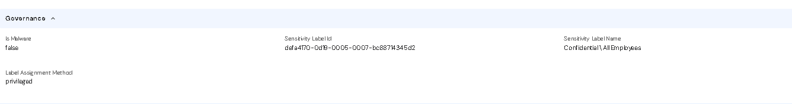
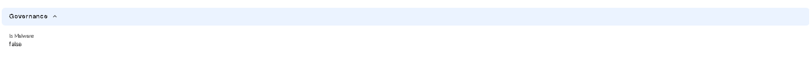

The customer's Microsoft 365 administrator performs these steps once per tenant, before creating the integration in Reva.

## Create the app registration

1. Open **https://entra.microsoft.com** and go to **Identity → Applications → App registrations → + New registration**.
2. Name: for example `reva-sharepoint-connector`.
3. Supported account types: **Accounts in this organizational directory only** (single tenant).
4. Redirect URI: leave empty. Click **Register**.

## Copy the two IDs

On the app's **Overview** page, copy the **Application (client) ID** and **Directory (tenant) ID**. Enter both on the integration form in [Enter the connection](/sharepoint/create-the-integration-in-the-reva-console#enter-the-connection).

## Add the Microsoft Graph permissions and grant consent

1. Open **API permissions → + Add a permission → Microsoft Graph → Application permissions**. Select Application permissions, not Delegated permissions.
2. Select `Sites.Read.All`, `Files.Read.All` and `Group.Read.All`. Click **Add permissions**.
3. Click **Grant admin consent for &lt;tenant name&gt;** and confirm. Every row must display a green tick and "Granted for &lt;tenant name&gt;".

## Create the client secret

1. Open **Certificates & secrets → Client secrets → + New client secret**.
2. Enter a description, for example `reva-connector`, and choose an expiry. Click **Add**.
3. Copy the **Value** column immediately. It is displayed only once. Do not copy the Secret ID.
4. Record the expiry date. The connector stops working when the secret expires ([Credentials Summary](/sharepoint/credentials-summary)).

Do not send the secret by email or chat. Enter it directly on the integration form.

## Turn on sensitivity labels in Microsoft Purview (for the Governance fields)

The **Governance** section of a file in Access Explorer (Sensitivity Label Id, Sensitivity Label Name, and Label Assignment Method) is populated only when the file has a Microsoft Purview sensitivity label. This does not require an additional Microsoft Graph permission: `Files.Read.All` from [Add the Microsoft Graph permissions and grant consent](/sharepoint/register-the-app-in-microsoft-entra-id#add-the-microsoft-graph-permissions-and-grant-consent) already allows the connector to read labels. The tenant must have labels configured, published, and applied to files. Without labels, Governance shows only **Is Malware**. The import succeeds either way.

<Frame caption="Figure 1. Governance with a sensitivity label applied to the file.">
  
</Frame>

<Frame caption="Figure 2. Governance for a file with no sensitivity label: only Is Malware.">
  
</Frame>

### Before you start

| Need | Details |
| --- | --- |
| Licence | A plan that includes sensitivity labels, such as Microsoft 365 Business Premium, E3 or E5. Each user who applies labels needs a licence. |
| Role | Global Administrator, Compliance Administrator or Information Protection Administrator, signed in to **https://purview.microsoft.com**. |
| Graph permission | No additional permission is required. `InformationProtectionPolicy.Read.All` is not needed: the label name comes from each file's own sensitivityLabel property. |

### Step 1. Let SharePoint and OneDrive process labels

1. Open **https://purview.microsoft.com** and go to **Solutions → Information Protection → Sensitivity labels**.
2. If a banner indicates that the organization has not enabled content processing in Office online files with encrypted sensitivity labels, click **Turn on now** and confirm. If no banner appears, this setting is already enabled.
3. Wait up to about 1 hour for the change to take effect.

### Step 2. Create the labels

1. On **Sensitivity labels**, click **+ Create a label**.
2. Enter a name and display name, for example `Public`, `Internal`, `Confidential` and `Restricted`.
3. Scope: choose **Files & other data assets**.
4. Protection settings: leave them disabled for an ordinary label. To encrypt files with a label, choose **Control access** and grant access to the appropriate users or groups.
5. Finish the wizard and click **Create label**. Repeat for each label.

### Step 3. Publish the labels

1. Go to **Information Protection → Publishing policies** (sometimes called **Label policies**) and click **+ Publish label**.
2. Choose the labels to publish.
3. Users and groups: choose **All**, or select the people who should be able to apply labels.
4. Default label: choose **None**, or select a default label if every new file should receive one.
5. Name the policy, for example `Company labels`, and click **Submit**.
6. Wait. Published labels can take **up to 24 hours** to appear in SharePoint, OneDrive, and Office.

### Step 4. Apply a label to files

1. In SharePoint, open the document library and select a file.
2. Open the **Details** pane (the i icon), find **Sensitivity**, and choose a label. If the Sensitivity field is missing or the list is empty, the labels may not have been published yet. Wait and try again.
3. Users can also choose a label in Word, Excel, or PowerPoint from **Home → Sensitivity**.

Labels work with Office files and PDFs. Some file types, such as plain text files, cannot carry sensitivity labels and therefore never display Governance details.

### Step 5. Run Sync in Reva

No changes are needed in Reva. The next [Sync](/sharepoint/test-and-run-the-import#sync) reads the labels. Open the file in Access Explorer and check the Governance section.

### How long each step takes

| Step | Wait before it works |
| --- | --- |
| Step 1. Let SharePoint and OneDrive process labels | Up to about 1 hour |
| Step 3. Publish the labels | Up to 24 hours |
| Step 4. Apply a label | Immediate; Reva shows it after the next Sync |

### What the Label Assignment Method means

| Value | Meaning |
| --- | --- |
| `standard` | Applied as a default label or by an app, not chosen by a person. |
| `privileged` | Chosen by a person, for example from the Details pane or the Sensitivity button. |
| `auto` | Applied by an auto-labelling policy in Microsoft Purview. |
