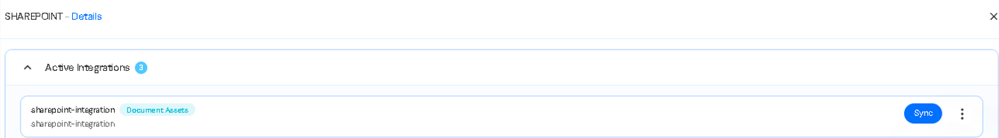
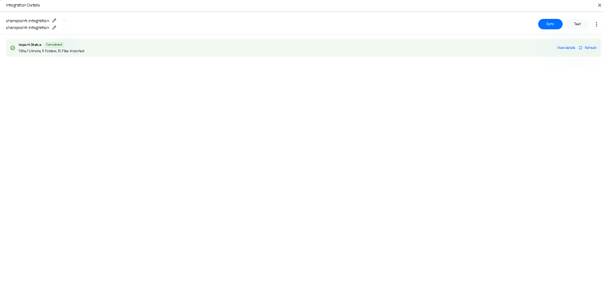

## Open the connection

1. On **Integrations**, open the **SharePoint** tile and select **Details**.
2. **Active Integrations** lists the connections. Click the name of the connection you created.

<Frame caption="Figure 6. SHAREPOINT Details. Each active connection has Sync and a menu.">
  
</Frame>

## Test

**Test** checks the connection. The connector requests a token with the client ID and secret, then reads `GET /v1.0/sites/root`. A wrong or expired secret returns the Entra ID error, for example `AADSTS7000215: Invalid client secret provided`. A permission without admin consent returns 403 and names `Sites.Read.All and Files.Read.All`.

## Sync

**Sync** starts an import. Imports also run automatically on a schedule. One import runs per connection at a time; a second request while one is running is refused, not queued.

When the import ends, Integration Details shows the status and the counts per entity type.

<Frame caption="Figure 7. Integration Details after a successful import: the status and how many of each entity type were imported.">
  
</Frame>

Click **View details** for the run record. It has these fields:

| Field | Meaning |
| --- | --- |
| connectionId, runId | The connection, and this import's id. |
| status | `pending`, `running`, `succeeded`, `failed` or `cancelled`. |
| progress total / fetched / ingested | Items found, items read, items accepted by Reva. A healthy run ends with all three equal. |
| resources | One row each for sites, libraries, folders and files, in that order, because parents are sent before their children. |
| error | Empty on success. On failure, the reason, for example an Entra ID error or a 403 that names the missing permission. |
