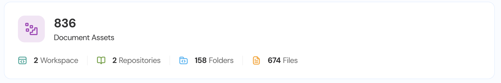

Open **Access Explorer**. The **Document Assets** card displays the totals for each entity type.

<Frame caption="Figure 8. The Document Assets card: the total for each entity type.">
  
</Frame>

Ask Reva AI a question, for example, "Show me all Files", and click a result to open its details. Attributes are grouped into Key Attributes, Ownership, Dates, Sharing & Access, and Governance.

- **Workspace, Repository and Parent Folder** contain the entity IDs of the linked site, library, and folder, rather than their names.
- **Created By, Last Modified By, and the reader, editor, and owner sets** contain Entra ID object IDs. These correspond to the users and groups imported from Microsoft Entra ID.
- **Id** is Reva's own ID for the entity. **External Id** is SharePoint's ID for the item.
- **Child Count** counts only the items directly inside a folder. **Size** includes everything beneath it. Both values reflect the folder's state at the time of the last import.
